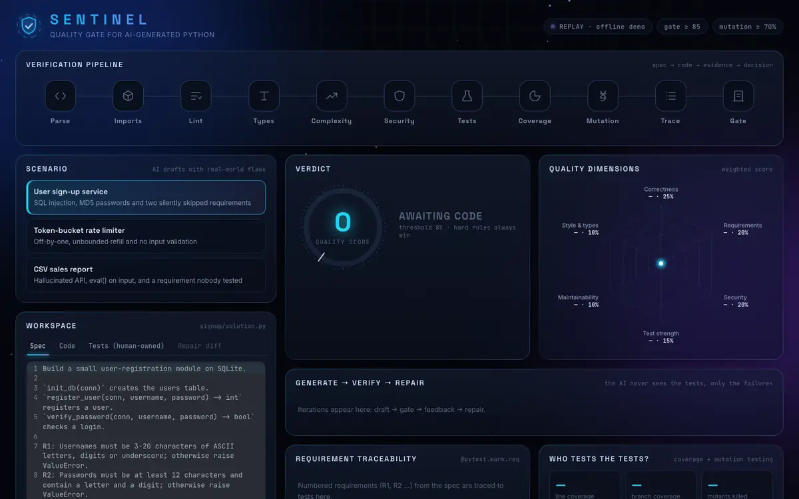
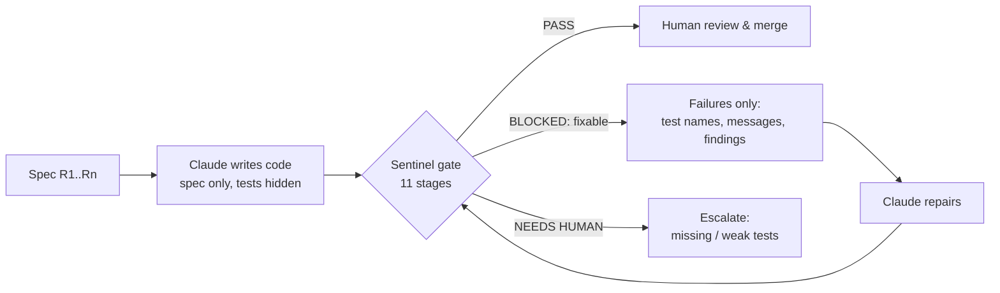

# Sentinel: a quality gate for AI-generated Python

[](https://github.com/TianweiZhou/sentinel-ai-code-gate/actions/workflows/ci.yml)




<sub>The *User sign-up* scenario: the AI's draft is blocked (SQL injection, MD5 passwords, missed requirements), the failures go back to the AI, and the repair passes. Replay mode, no API key needed.</sub>

> **The problem:** AI can write code faster than anyone can review it, and the code usually *looks* right.
> **The idea:** treat every AI change like a pull request from a new teammate. It has to **prove** it meets the
> requirements before it merges, and if it can't, the AI gets the exact failures back and fixes them.

Sentinel runs AI-written Python through 11 checks, scores it, and makes a **pass / block / escalate** decision.
Blocked code goes back to Claude with the failure reasons, up to 3 times. Problems the AI shouldn't fix on its own
(missing tests, weak tests) are **escalated to a human**.

It runs in three places, all using the same engine:

| Where | How |
|---|---|
| **Dashboard** | Animated web UI that streams each stage live, with an iteration timeline, the repair diff, requirement traceability and mutation results |
| **CLI** | `python -m sentinel check solution.py --tests test_solution.py --spec SPEC.md` (exit code 1 = blocked) |
| **GitHub Action** | `uses: TianweiZhou/sentinel-ai-code-gate@v1.0.0` in any repo. Posts the score as a PR comment and fails the check when blocked |

---

## How AI code fools you, and what catches it

| Failure mode of AI code | Stage | Tool |
|---|---|---|
| Invents a package or API (`from statistics import weighted_mean`); a hallucinated name can be registered by an attacker on PyPI | **Imports**: every import must resolve, and third-party packages must be on an allow-list | `ast` + `importlib` |
| Subtle bugs, unidiomatic code | **Lint** | `ruff` |
| `None` where a value is required, wrong types | **Types** | `mypy --strict` |
| One 200-line function with deep nesting | **Complexity**: cyclomatic ≤ 8, depth ≤ 3, ≤ 40 lines per function | `radon` + AST |
| `eval`, string-built SQL, MD5 passwords, `shell=True`, hard-coded keys | **Security** (severities raised for unreviewed code) | `bandit` |
| Doesn't actually do what was asked | **Tests**: human-owned acceptance tests in an isolated process with timeouts | `pytest` |
| Tests only cover the happy path | **Coverage**: line + branch, ≥ 80% | `coverage.py` |
| **Tests too weak to catch real bugs** | **Mutation testing**: plants bugs (`<`→`<=`, `+`→`-`, `return x`→`return None` …) and requires ≥ 70% to be caught | built in (`sentinel/stages/dynamic.py`) |
| A requirement is quietly skipped | **Traceability**: each test is tagged `@pytest.mark.req("R3")`; a requirement with no passing test can't pass | pytest marker |
| A high average hides one serious problem | **Gate**: weighted score **plus hard rules** | `sentinel/gate.py` |

### The gate decision

```
score = 25% correctness + 20% requirements + 20% security + 15% test strength + 10% maintainability + 10% style/types
```

Then the **hard rules** apply. Any one of these blocks the code, whatever the score:

- doesn't parse, invented import/API, any failing test, any critical/high security finding, any requirement not met → **BLOCKED (sent back to the AI)**
- a requirement with no test, coverage < 80%, mutation score < 70% → **NEEDS HUMAN** (the AI is not allowed to write its own exam)
- score < 85 → BLOCKED

### The loop



Design rules that keep the loop honest:
1. **The AI never sees the test source.** Tests work like a held-out exam. If the model can read them, it learns to special-case the assertions.
2. **Tests and spec are human-owned.** Repair only changes `solution.py`. Problems with the tests go to a human.
3. **Tests outrank the LLM judge.** In live mode Claude also reviews requirements, but it can only *downgrade* a result. An opinion is not proof.
4. **No silencing.** The repair prompt forbids `# noqa`, `# type: ignore` and `# nosec`.
5. **Structured output only.** Claude's responses are validated against Pydantic schemas, not regex-parsed from Markdown.

---

## Quick start

Requires Python 3.12+, [uv](https://docs.astral.sh/uv/) and Node 20+.

```bash
uv sync                      # Python engine + tools (ruff, mypy, bandit, radon, pytest, coverage)
npm install                  # dashboard
```

Run the API and the dashboard in two terminals:

```bash
uv run uvicorn sentinel.api:app --port 8000 --reload
```

```bash
npm run dev                  # http://localhost:5173
```

**Replay mode (default, offline):** the three built-in scenarios use a recorded AI draft and a recorded repair, so the
demo never depends on the network.
**Live mode:** set `ANTHROPIC_API_KEY` before starting the API. Claude (`claude-opus-5-5`, override with
`SENTINEL_MODEL`) then writes, repairs and reviews the code, with server-side refusal fallbacks enabled.

### Demo scenarios

| Scenario | What the AI got wrong | Outcome |
|---|---|---|
| **User sign-up** | SQL injection, MD5 passwords, no password rules, case-sensitive duplicates | 55 → **99 PASS** after one repair |
| **Rate limiter** | `>` instead of `>=`, refill above capacity, no validation | 59 → **100 PASS** |
| **CSV sales report** | hallucinated `statistics.weighted_mean`, `eval()` on input, 5-level nesting | 16 → 96 but **NEEDS HUMAN**: R5 has no test |

### CLI

```bash
uv run python -m sentinel check --sample signup --repair
uv run python -m sentinel check examples/rate_limiter/solution.py \
  --tests examples/rate_limiter/test_solution.py --spec examples/rate_limiter/SPEC.md \
  --json report.json --markdown report.md
```

### Use it in another repository

```yaml
# .github/workflows/ai-quality-gate.yml
on: pull_request
permissions: { contents: read, pull-requests: write }
jobs:
  gate:
    runs-on: ubuntu-latest
    steps:
      - uses: actions/checkout@v4
      - uses: TianweiZhou/sentinel-ai-code-gate@v1.0.0
        with:
          code: src/billing.py
          tests: tests/test_billing.py
          spec: specs/billing.md
          allow: requests pydantic
```

---

## Project layout

```
sentinel/
  stages/static.py        parse, imports (hallucination check), ruff, mypy, radon, bandit
  stages/dynamic.py       pytest + coverage in a subprocess, mutation testing
  stages/requirements.py  spec parsing, test↔requirement tracing, LLM-judge merge
  gate.py                 weights, thresholds, hard rules, fix-vs-escalate
  pipeline.py             stage runner + generate → verify → repair loop (event stream)
  llm.py                  Claude: generate / repair / judge (structured output)
  workspace.py            isolated temp dir, scrubbed env, timeouts
  api.py  cli.py          FastAPI (NDJSON streaming) and CLI
web/src/                  React + TypeScript + Framer Motion dashboard
action.yml                reusable GitHub Action
.github/workflows/ci.yml  Sentinel checks itself (ruff, mypy --strict, pytest, build), then gates the example
tests/                    unit tests + every demo scenario end to end
```

## Known limits (deliberate trade-offs)

- **The sandbox is process isolation, not a security boundary.** Candidate code runs in a subprocess with a scrubbed
  environment (no API keys) and timeouts. In production, run the same commands inside a container with no network and a
  read-only filesystem (e.g. gVisor/Firecracker).
- **Python only.** The gate, scoring and loop don't depend on the language. Adding a language means adding analyzers
  (for example ESLint, tsc and Stryker for TypeScript).
- **One module per run.** Real repositories need diff-aware gating (only check changed functions) and caching.
- **The mutation tester is deliberately small** (6 operators, at most 24 mutants, run in parallel) so it stays fast
  enough for CI. `mutmut` or `cosmic-ray` give deeper analysis.
- **Tools can't judge design.** Sentinel narrows what humans have to review; it doesn't replace review.

## Troubleshooting

On macOS, if `uv run sentinel` fails with `No module named 'sentinel'`, the folder is probably syncing (e.g. with iCloud)
and the `.pth` file got the "hidden" flag, which Python skips. Run `uv run python -m sentinel …` from the project root
instead.
